<div align="center">

# Kadrom

**İstanbul'daki otel, restoran ve kafeleri vardiyalı personelle buluşturan platform. Komisyon yok.**

İşletme ilanı vardiya vardiya açar, aday istediği vardiyalara başvurur. Kabul, mesajlaşma,
kapıda QR ile giriş ve yoklama aynı uygulamada yürür.

[](https://github.com/calsgnkadir/hotel-platform/actions/workflows/ci.yml)


</div>

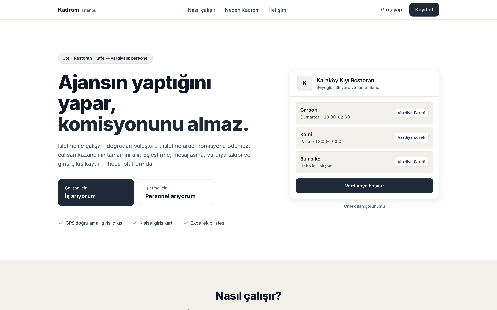

> **Canlı sürüm yok.** <https://hotel-platform-seven.vercel.app/> yalnızca arayüz önizlemesidir;
> arkasında çalışan bir sunucu olmadığı için giriş, ilan listesi ve mesajlaşma orada çalışmaz.
> Uygulamanın tamamını görmek için [Docker ile yerelde çalıştırın](#hızlı-başlangıç-docker).

---

## İçindekiler

- [Ekran görüntüleri](#ekran-görüntüleri)
- [Özellikler](#özellikler)
- [Teknoloji](#teknoloji)
- [Hızlı başlangıç (Docker)](#hızlı-başlangıç-docker)
- [Yerel geliştirme](#yerel-geliştirme)
- [Google ile giriş](#google-ile-giriş-isteğe-bağlı)
- [Testler ve CI](#testler-ve-ci)
- [Yayın durumu](#yayın-durumu)
- [Yol haritası](#yol-haritası)

---

## Ekran görüntüleri

> Görseller örnek (sahte) verilerle hazırlanmıştır; gerçek kişi veya işletme bilgisi içermez.

### Aday

<table>
<tr>
<td width="50%"><b>İlanlar</b>: tarih, vardiya saati, çalışma türü ve ücrete göre filtre<br/>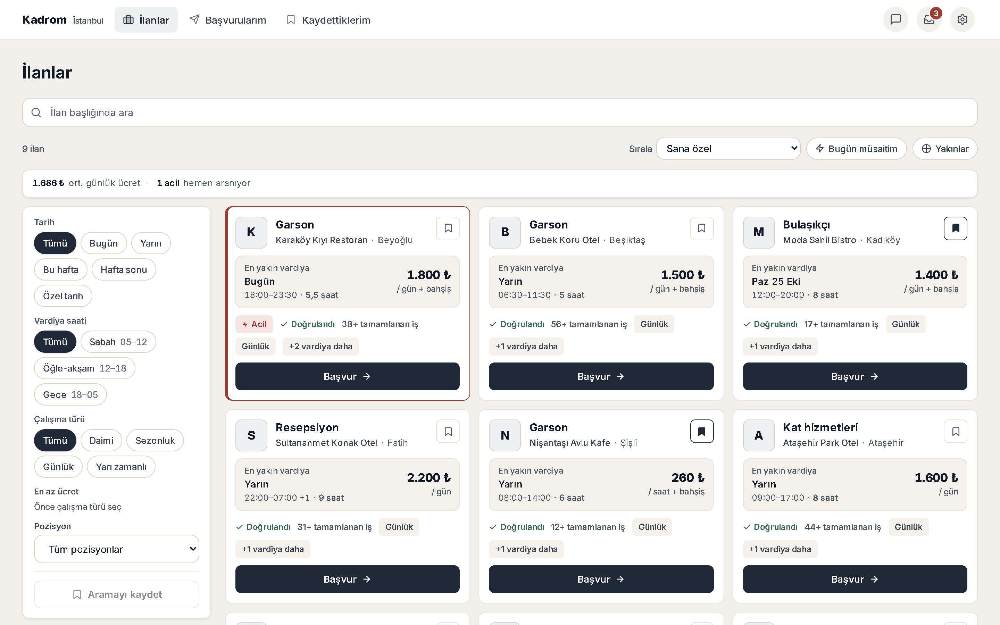</td>
<td width="50%"><b>İlan detayı</b>: vardiyalar, ödeme, kıyafet, toplanma yeri<br/>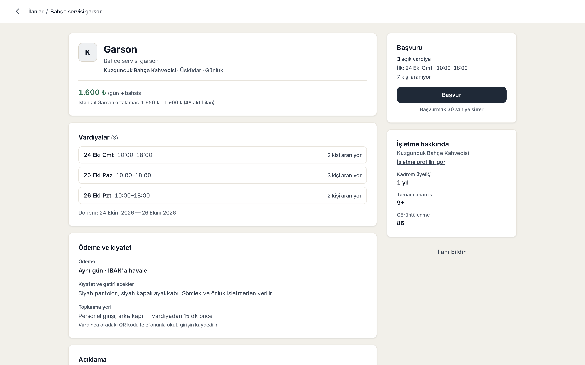</td>
</tr>
<tr>
<td width="50%"><b>Başvurularım</b>: durum, vardiya, yedek sırası, mesaiye başla<br/>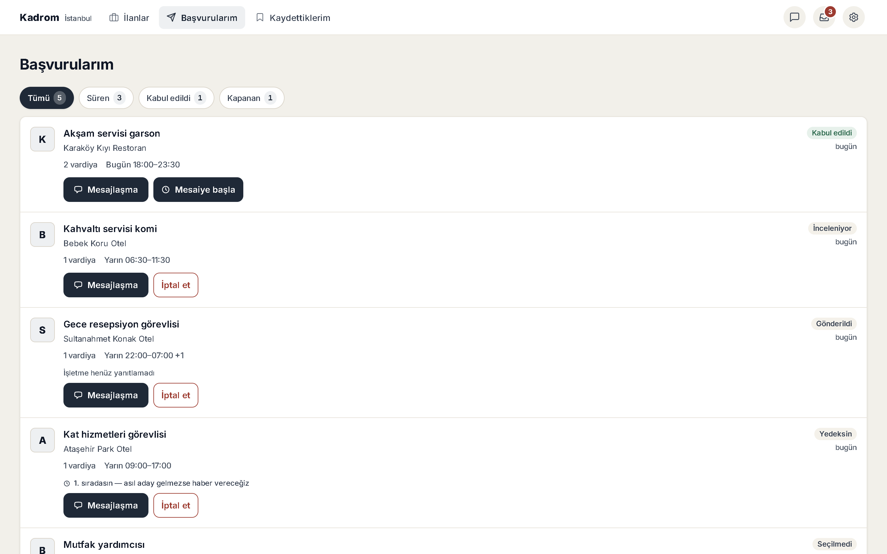</td>
<td width="50%"><b>Geçmiş işlerim</b>: çalışılan vardiyalar ve toplam saat<br/>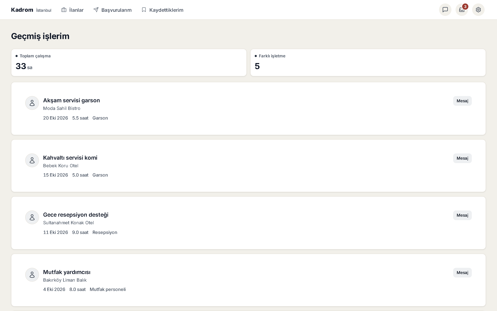</td>
</tr>
</table>

### İşletme

<table>
<tr>
<td width="50%"><b>Genel bakış</b>: yapılacaklar ve son hareketler<br/>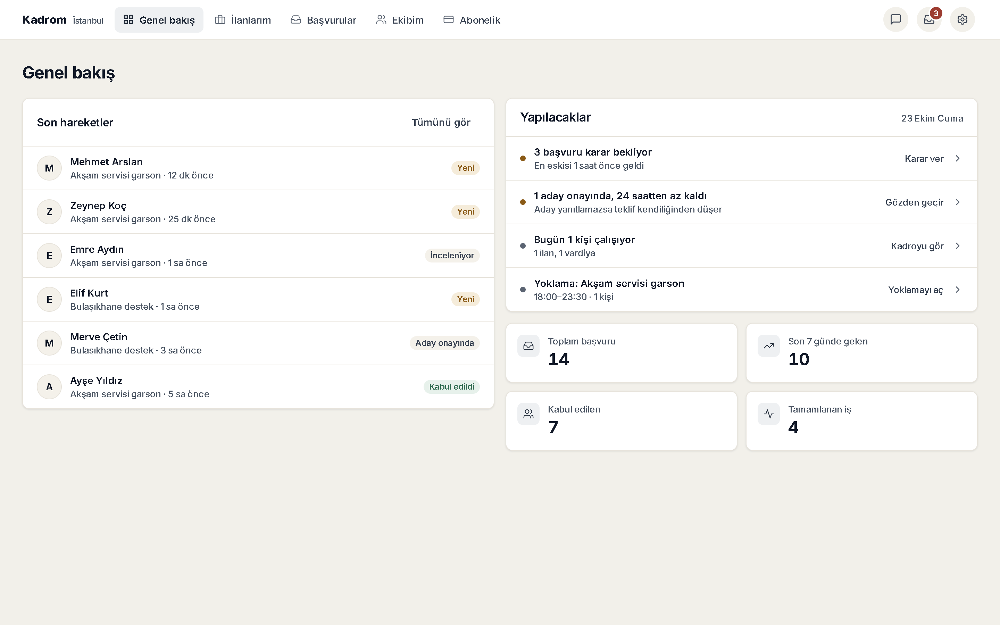</td>
<td width="50%"><b>İlanlarım</b>: doluluk, görüntülenme, yoklama<br/>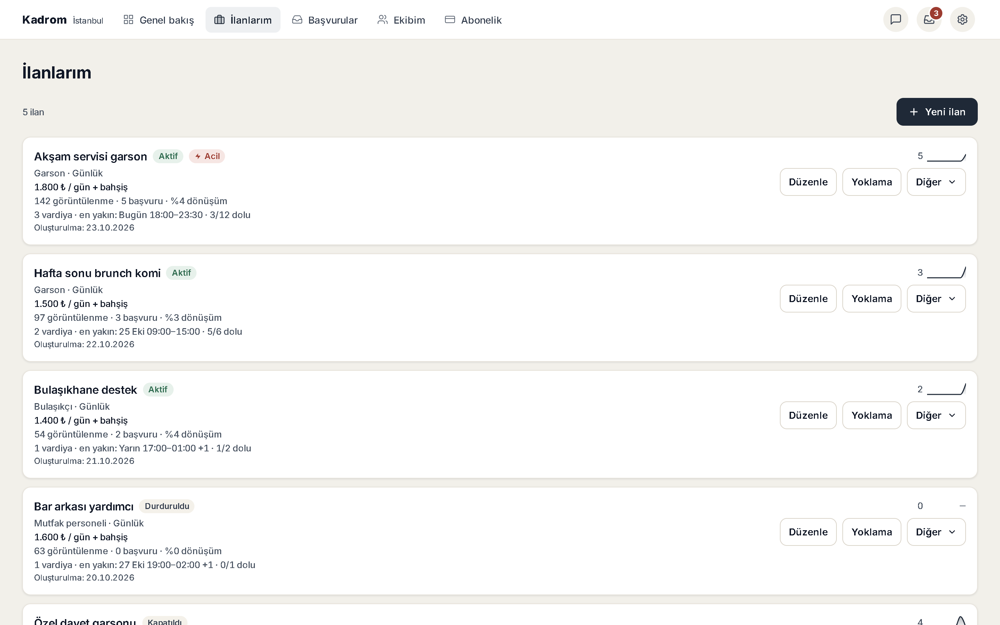</td>
</tr>
<tr>
<td width="50%"><b>Başvurular, Kanban görünümü</b><br/>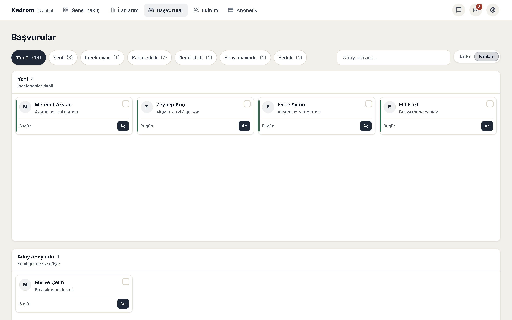</td>
<td width="50%"><b>Başvurular, liste görünümü</b><br/>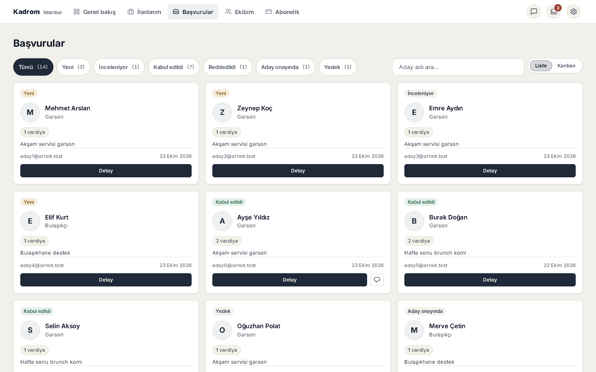</td>
</tr>
<tr>
<td width="50%"><b>Yoklama</b>: QR ile kapıda giriş, elle "Geldi", Excel ekip listesi<br/>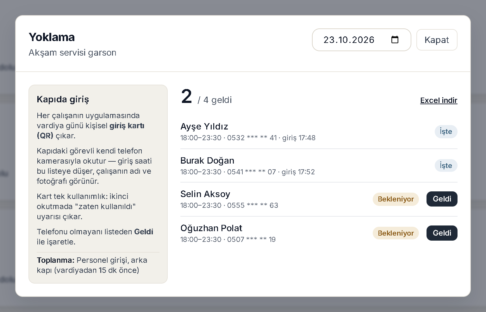</td>
<td width="50%"><b>Ekibim</b>: bizde çalışanlar, favoriler, engellenenler<br/>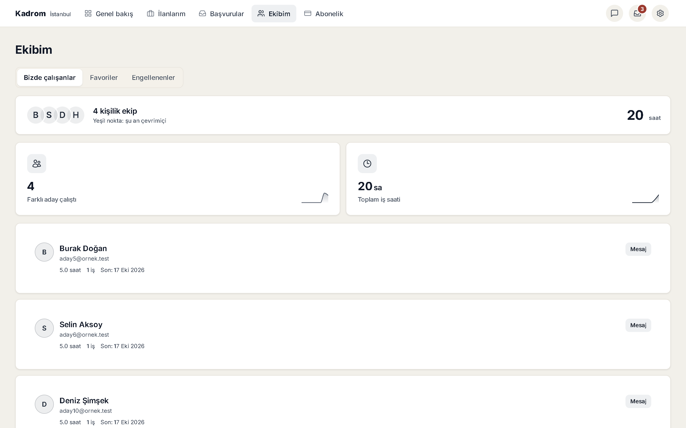</td>
</tr>
<tr>
<td colspan="2"><b>İşletme profili</b>: profil doluluğu ve adayın gördüğü canlı önizleme<br/>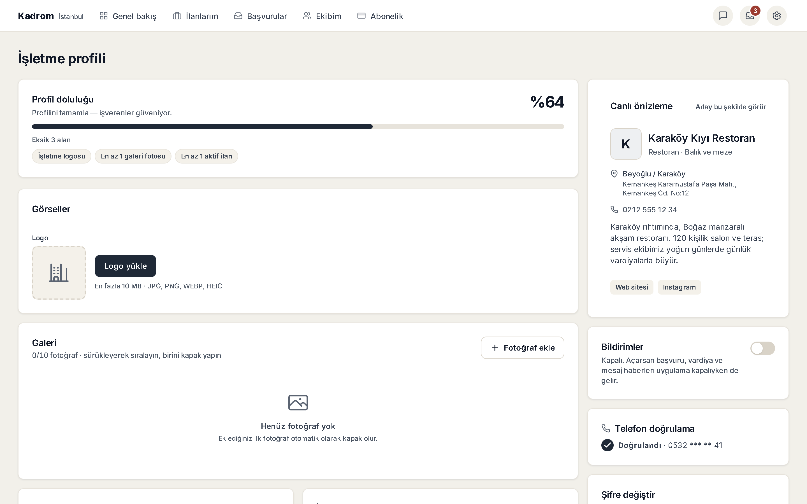</td>
</tr>
</table>

### Ortak ve yönetim

<table>
<tr>
<td width="50%"><b>Mesajlar</b>: başvuru bağlamlı sohbet, hızlı yanıtlar, ekler<br/>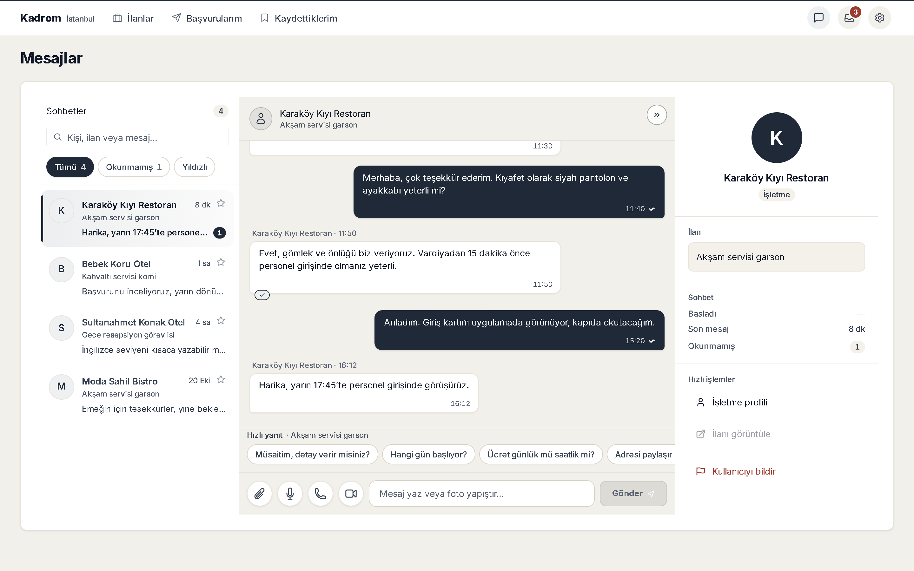</td>
<td width="50%"><b>Yönetim paneli</b>: kullanıcı, ilan, şikayet, destek, işlem geçmişi<br/>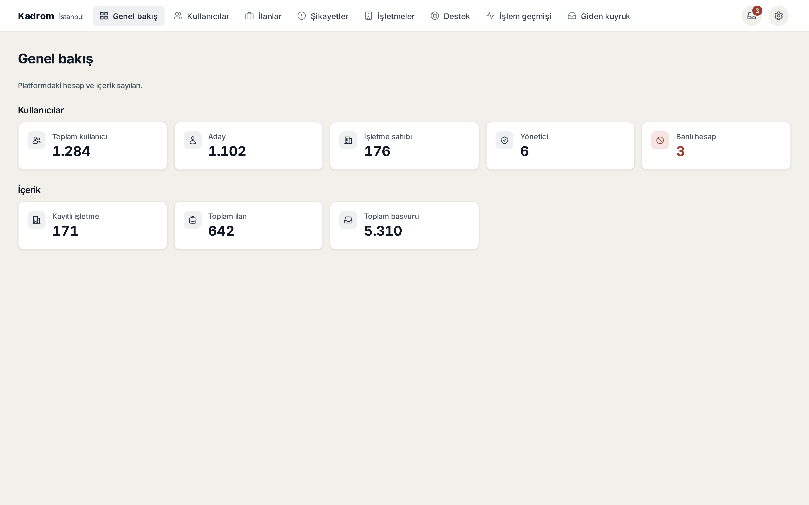</td>
</tr>
</table>

### Mobil

<p>
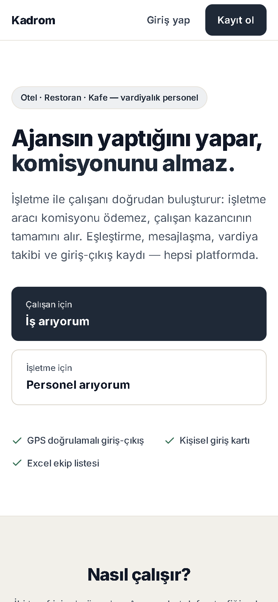
&nbsp;
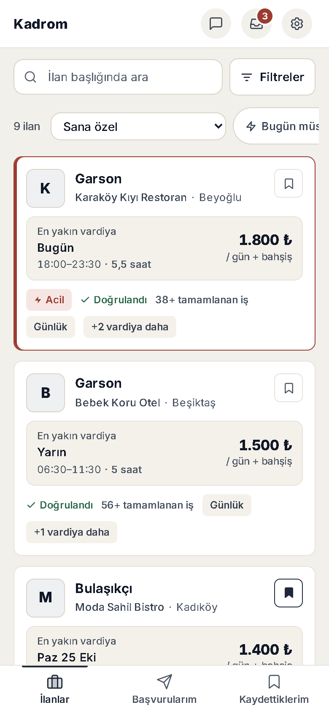
&nbsp;
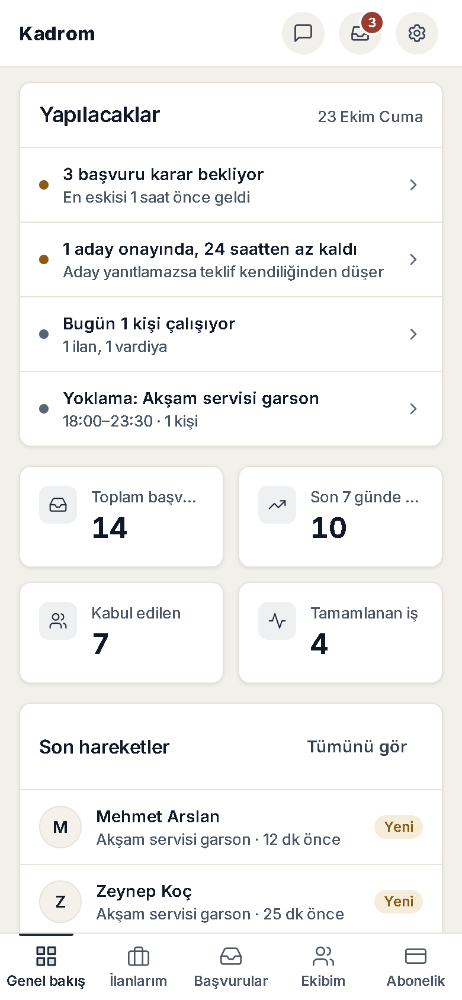
</p>

---

## Özellikler

### Aday

- **Vardiya bazlı başvuru:** bir ilanın vardiyalarından istenenler seçilir; her vardiya ayrı takip edilir.
- **Gece vardiyası:** ertesi güne taşan vardiyalar (ör. 22:00–07:00) ilan, giriş kartı, yoklama ve kazanç hesabında doğru işlenir. Müsaitlik de gece bloğu olarak girilebilir.
- **Filtre ve sıralama:** tarih, vardiya saati, çalışma türü, pozisyon, en az ücret; "Sana özel" sıralama, yakınlık, "Bugün müsaitim".
- **Kayıtlı aramalar ve kaydedilen ilanlar:** yeni eşleşen ilan çıkınca bildirim.
- **Yedek aday:** kontenjan doluysa aday yedeğe alınır; asıl aday düşerse sıradaki yedeğe süreli teklif gider.
- **Giriş ve çıkış:** vardiya günü kişisel tek kullanımlık QR giriş kartı; mesai başlangıç ve bitişi GPS ile işyerine uzaklık kontrolüyle kaydedilir.
- **Geçmiş işlerim:** tamamlanan vardiyalar ve toplam çalışma saati.

### İşletme

- **İlan editörü:** tarih, saat ve kişi sayısıyla vardiya listesi; ücret birimi (saatlik, günlük, aylık), ödeme zamanı ve şekli, kıyafet, toplanma yeri.
- **Başvuru yönetimi:** Kanban ve liste görünümü; kabul, red, aday onayına sunma, yedeğe alma.
- **Gelmedi ve ceza vardiya başına:** her gelmeyen vardiya ayrı kayıt ve ayrı ceza; çalışılan vardiyalar korunur. Üç gelmedi işaretinde aday 30 gün askıya alınır.
- **Yoklama:** QR okutma, elle "Geldi" işaretleme, Excel ekip listesi.
- **Acil ilan:** o an müsait adaylara bildirim.
- **Ekibim:** bizde çalışanlar, favori adaylar, engellenen adaylar.
- **İşletme profili:** logo, sıralanabilir galeri, çalışma saatleri, harita konumu, herkese açık işletme sayfası.
- **İlan kotası:** ücretsiz planda aynı anda en fazla 5, ücretli abonelikte en fazla 10 aktif ilan. Duraklatılan ve kapanan ilanlar sayılmaz. Ödeme altyapısı (iyzico) kodda hazır ancak anahtar verilmediği sürece kapalıdır; açılışta ödeme alınmaz.
- **İlan yaşam döngüsü:** ilan son vardiyası bitince kendiliğinden kapanır; açık başvurular "süresi doldu" olur.

### Ortak

- **Mesajlaşma:** başvuruyla açılan sohbet, WebSocket ile anlık iletim, okundu bilgisi, yanıtlama, tepki, dosya ve fotoğraf eki (ekler yalnız sohbetin iki tarafına açık).
- **Bildirimler:** uygulama içi, WebSocket ve Web Push (VAPID); e-posta (Resend).
- **Engelleme ve şikayet:** aday işletmeyi, işletme adayı engelleyebilir; şikayetler yönetim panelinde incelenir.
- **KVKK:** kayıtta aydınlatma metni onayı ve onay kaydı, kişisel verileri dışa aktarma (`GET /api/me/export`), hesap silme ve anonimleştirme (`DELETE /api/me`).
- **Google ile giriş (isteğe bağlı):** yapılandırılmamışsa düğme gizlenir.
- **Yönetim paneli:** kullanıcılar, ilanlar, işletme doğrulama, şikayetler, destek talepleri, işlem geçmişi, giden e-posta kuyruğu.

---

## Teknoloji

| Katman | Kullanılan |
| :-- | :-- |
| Backend | Spring Boot 4.1.1, Java 17, Spring Security, JWT (erişim + yenileme), STOMP/WebSocket, OAuth2 Client |
| Veritabanı | MySQL 8, Flyway (V1–V27), Hibernate `ddl-auto=validate` |
| Frontend | React 18, Vite 5, Tailwind CSS 3, TanStack Query 5, React Router 6, React Hook Form, Leaflet |
| Depolama | Cloudinary (sohbet ekleri gizli, işletme görselleri herkese açık) |
| Diğer | Bucket4j (istek sınırı), Apache POI (Excel), springdoc (Swagger), iyzico (kapalı), Resend (e-posta) |
| Test | JUnit 5, Vitest + Testing Library, Playwright |
| Paketleme | Docker, Docker Compose (MySQL + backend + nginx) |

```
hotel-platform/
├── hotelapp/        Spring Boot backend (controller, service, repository, entity, security, config)
│   └── src/main/resources/db/migration   Flyway betikleri
├── hotel-web/       React arayüzü (pages, components, api, lib, context)
│   └── e2e/         Playwright testleri
├── deploy/          Sunucu yayını için örnek yapılandırmalar
└── docker-compose.yml
```

---

## Hızlı başlangıç (Docker)

Docker kurulu bir makinede tüm sistem tek komutla açılır:

```bash
git clone https://github.com/calsgnkadir/hotel-platform.git
cd hotel-platform
cp .env.example .env        # DB_PASSWORD ve JWT_SECRET (en az 32 karakter) değerlerini girin
docker compose up --build
```

| Servis | Adres |
| :-- | :-- |
| Arayüz | <http://localhost:5174> |
| API | <http://localhost:8081> (Swagger: <http://localhost:8081/swagger-ui.html>) |
| MySQL | `localhost:3307` |

Portlar, yerel geliştirme ortamıyla (5173, 8080, 3306) çakışmayacak şekilde seçildi.
Compose, backend'i `dev,demo` profiliyle başlatır; şema Flyway ile kurulur ve demo verisi yüklenir.

### Demo hesaplar

Yalnızca `demo` profilinde (prod dışında) yüklenir.

| Rol | E-posta | Şifre |
| :-- | :-- | :-- |
| Aday | `demo-aday1@test.com` | `Demo1234!` |
| İşletme | `demo-isletme1@test.com` | `Demo1234!` |

Seeder `demo-aday1` … `demo-aday10` ve `demo-isletme1` … `demo-isletme6` hesaplarını aynı şifreyle oluşturur.

```bash
docker compose logs -f backend   # log takibi
docker compose down              # durdur (veri volume'de kalır)
docker compose down -v           # veritabanını da sil
```

---

## Yerel geliştirme

Gereksinimler: Java 17, Node 20, MySQL 8.

**1. Veritabanı**

```sql
CREATE DATABASE hotel_platform CHARACTER SET utf8mb4 COLLATE utf8mb4_turkish_ci;
```

**2. Backend** (port 8080)

```bash
cd hotelapp
cp .env.example .env    # değerleri doldurun
mvn spring-boot:run     # ya da IntelliJ'de HotelStudentPlatformApplication
```

Demo verisi için `SPRING_PROFILES_ACTIVE=dev,demo`. Swagger: <http://localhost:8080/swagger-ui.html>
(prod profilinde kapalıdır).

**3. Frontend** (port 5173)

```bash
cd hotel-web
npm install
npm run dev
```

Vite `strictPort` ile çalışır: 5173 doluysa başka porta kaymaz, hata verir. `/api` ve `/ws`
istekleri 8080'deki backend'e yönlendirilir.

### Ortam değişkenleri

Değerler `.env.example` dosyalarındadır; gerçek anahtarları depoya koymayın.

| Dosya | Değişkenler |
| :-- | :-- |
| `.env.example` (Docker) | `DB_PASSWORD`, `JWT_SECRET` |
| `hotelapp/.env.example` | `DB_HOST`, `DB_PORT`, `DB_NAME`, `DB_USERNAME`, `DB_PASSWORD`, `JWT_SECRET`, `JWT_EXPIRATION`, `SERVER_PORT`, `APP_BASE_URL`, `CLOUDINARY_URL`, `RESEND_API_KEY`, `RESEND_FROM`, `RESEND_FROM_NAME`, `GOOGLE_CLIENT_ID`, `GOOGLE_CLIENT_SECRET`, `FILE_UPLOAD_DIR`, `JPA_DDL_AUTO`, `JPA_SHOW_SQL`, `LOG_LEVEL`, `LOG_LEVEL_SECURITY`, `PWD_RESET_EXPIRY_HOURS` |
| `hotel-web/.env.example` | `VITE_API_URL` |

İlan kotası ve ödeme `BILLING_*` ve `IYZICO_*` değişkenleriyle ayarlanır (varsayılanlar
`hotelapp/src/main/resources/application.yml` içinde). `IYZICO_API_KEY` boşsa ödeme kapalıdır.

---

## Google ile giriş (isteğe bağlı)

1. Google Cloud Console'da bir OAuth 2.0 istemcisi (Web uygulaması) oluşturun.
2. Yetkili yönlendirme adresi: `http://localhost:8080/login/oauth2/code/google`
3. `hotelapp/.env` içine `GOOGLE_CLIENT_ID` ve `GOOGLE_CLIENT_SECRET` girin, backend'i yeniden başlatın.

Bu değerler yoksa sunucu yine açılır, giriş ekranında Google düğmesi görünmez ve e-posta/şifre
girişi çalışır. Google ile ilk kez giriş yapan kullanıcıya **aday** hesabı açılır; işletme hesabı
e-posta ile kayıt olarak açılır. İlk girişte KVKK onayı istenir.

---

## Testler ve CI

```bash
cd hotelapp && mvn verify     # backend birim + entegrasyon testleri
cd hotel-web && npm test      # Vitest
cd hotel-web && npm run build
cd hotel-web && npm run e2e   # Playwright (çalışan backend ve MySQL gerekir)
```

| Katman | Kapsam |
| :-- | :-- |
| Backend | 700+ birim testi, 45 entegrasyon testi (JUnit 5) |
| Frontend | 507 test, 75 dosya (Vitest) |
| E2E | Playwright, gerçek MySQL ve backend ile |

GitHub Actions (`.github/workflows/ci.yml`) her push ve pull request'te üç iş çalıştırır:
backend `mvn verify`, frontend `vitest` + `vite build`, ve MySQL 8 servisiyle ayağa kaldırılan
backend'e karşı Playwright E2E. `daily-health-check.yml` canlı backend olmadığı için yalnız elle
tetiklenir.

---

## Yayın durumu

- **Canlı backend yok.** Önceki barındırma denemeleri (Railway, Render) kullanılmıyor.
- **Arayüz önizlemesi:** <https://hotel-platform-seven.vercel.app/> (Vercel, yalnız statik arayüz).
- **Plan:** sunucunun Türkiye'de barındırılması. O zamana kadar uygulamayı denemenin yolu
  [Docker ile yerel kurulum](#hızlı-başlangıç-docker).

---

## Yol haritası

Tamamlananların ayrıntısı commit geçmişindedir. Açık işler:

- [ ] KVKK aydınlatma metnindeki yer tutucuların (şirket unvanı, adres, iletişim) doldurulması ve hukuki inceleme
- [ ] Onay metni sürümünün sunucu tarafında kontrolü
- [ ] Veri dışa aktarma ve anonimleştirme kapsamının gözden geçirilmesi
- [ ] Geçmiş işler ve işletme paneli listelerinde sayfalama
- [ ] Yönetim paneli tablolarında sayfalama
- [ ] Türkiye'de sunucuya yayın

